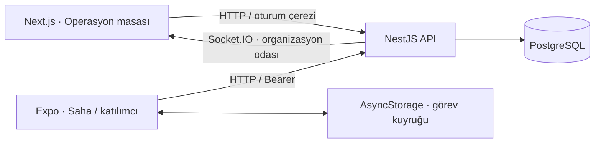

# Stageflow

**Sahne arkası, kontrol altında.**


Festival programını, saha görevlerini, ekip vardiyalarını, ekipmanı ve bilet girişlerini aynı çalışma alanında yöneten web ve mobil uygulama. Next.js operasyon masası ve React Native saha uygulaması, NestJS API üzerinden aynı PostgreSQL verisini kullanır.

Arayüzde beyaz/grafit zemin, turuncu vurgu, fotoğraflı festival tanıtımı ve okunaklı operasyon tabloları kullanılır. Mobil deneyimde programa tek dokunuşla erişim, sade görev kartları ve tutarlı çizgi simgeleri bulunur. [Görseller ve üretim istemleri](docs/ASSETS.md).

## Neler yapar?

- **Sahne programı:** Performans oluşturma, düzenleme ve sürükleyerek taşıma; sahne ve sanatçı saat çakışmalarını sunucuda engelleme.
- **Görevler:** Sorumlu, öncelik, bitiş saati ve bağımlılıklar. Ön koşul tamamlanmadan bağlı görev başlatılamaz.
- **Canlı çalışma alanı:** Web değişiklikleri organizasyon odaları üzerinden Socket.IO ile alır. Mobil, bağlantı varken 12 saniyelik yenileme ve elle yenileme kullanır.
- **Saha uygulaması:** Ekip görevleri, vardiyalar, alan planı, ekipman QR arama/iade ve fotoğraflı olay bildirimi.
- **Çevrimdışı görev kuyruğu:** Görev durumları cihazda saklanır, bağlantı gelince aynı işlem anahtarıyla yeniden gönderilir. Çakışmalar sessizce ezilmez; kullanıcı incelemesi için bekletilir.
- **Ekipman:** Zaman aralığına göre kapasite kontrolü, rezervasyon, QR etiketi ve iade.
- **Ekip:** Çakışmayan vardiyalar ve kişi bazında açık görevler.
- **Giriş:** İmzalı QR bilet ve atomik tek kullanımlık giriş kontrolü.
- **Katılımcı:** Program, favoriler, şematik alan planı ve kendi bileti. İç operasyon verileri katılımcıya gönderilmez.
- **İşlem geçmişi:** Değişikliklerin kullanıcı ve zaman bilgisiyle kaydı, webden JSON indirme.

## Mimari



| Katman | Teknoloji |
| --- | --- |
| Web | Next.js 16, React 19, TypeScript, Lucide, Socket.IO client |
| Mobil | Expo 58, React Native 0.88, SecureStore, AsyncStorage, Camera, ImagePicker |
| API | NestJS 12, Zod, JWT, Swagger, Socket.IO |
| Veri | PostgreSQL 17, SQL işlemleri, satır kilitleri, organizasyon bazlı advisory lock |
| Doğrulama | Node test runner, gerçek ve ayrı PostgreSQL test veritabanı |

## Hızlı başlangıç · Windows

Node.js 24, Python 3 ve PostgreSQL 17'nin kurulu olması gerekir. PostgreSQL `bin` klasörü farklıysa `PG_BIN` ortam değişkenini ayarla.

1. Depoyu indir veya klonla.
2. **`BASLAT.cmd`** dosyasını aç. İlk çalıştırmada bağımlılıklar kurulur.
3. Terminal açıkken aşağıdaki adresleri kullan.

| Ekran | Adres |
| --- | --- |
| Web | http://127.0.0.1:9148 |
| Mobil web önizlemesi | http://localhost:9150 |
| Swagger | http://127.0.0.1:9149/api/docs |
| API sağlık | http://127.0.0.1:9149/api/health |

Alternatif terminal kurulumu:

```powershell
npm ci --workspaces=false --ignore-scripts --no-audit --no-fund
python scripts/run.py --mobile
```

Başlatıcı, `.runtime/postgres` altında projeye özel PostgreSQL kümesi oluşturur ve **55452** portunda yalnızca loopback üzerinden açar. Başka projelerin veritabanını değiştirmez. Yerel geliştirme kümesi parola istemeyen `trust` kimlik doğrulaması kullanır; internete açılmamalıdır. Ctrl+C, başlatıcının açtığı uygulamaları ve veritabanını kapatır. Veriler bir sonraki çalıştırmada korunur.

### Demo hesaplar

Tüm örnek hesapların parolası: **`Stageflow2026!`**

| E-posta | Yetki |
| --- | --- |
| admin@stageflow.local | Organizatör |
| stage@stageflow.local | Sahne yöneticisi |
| tech@stageflow.local | Teknik ekip; kendi görevleri ve ekipman |
| gate@stageflow.local | Giriş personeli |
| guest@stageflow.local | Katılımcı |

Örnek Northline Festival, **24–25 Ekim 2026 / İstanbul** tarihlidir. Tüm etkinlik saatleri arayüzde İstanbul saatine göre gösterilir. Kayıtlar ilk açılışta eklenir; yeniden başlatma kullanıcı değişikliklerini sıfırlamaz.

## Fiziksel telefonda geliştirme

Bilgisayar ve telefon aynı yerel ağda olmalı. Yerel başlatıcıyı kapatıp PostgreSQL kümesini aç; ardından API'yi ve Expo'yu ayrı terminallerde çalıştır:

```powershell
# Terminal 1
& "$env:ProgramFiles\PostgreSQL\17\bin\pg_ctl.exe" -D .runtime/postgres -o "-h 127.0.0.1 -p 55452" -w start
$env:API_HOST="0.0.0.0"
npm run dev:api

# Terminal 2 — örnek IP yerine bilgisayarının LAN IP adresini yaz
$env:EXPO_PUBLIC_API_URL="http://192.168.1.20:9149"
npm run dev:mobile
```

Expo'nun gösterdiği QR kodu uygun sürümdeki Expo Go veya geliştirme istemcisiyle aç. İşletim sistemi güvenlik duvarında yalnızca güvenilir yerel ağ için gereken erişimi ver. Kamera ve fotoğraf izinleri kullanım anında istenir. `127.0.0.1` telefonda bilgisayarı göstermez.

## Docker ile web + API

```powershell
node scripts/setup-env.mjs
docker compose up --build
```

`DOCKER_BASLAT.cmd` aynı işlemleri uygular. `.env` içine rastgele JWT imzalama anahtarı oluşturulur; dosya Git'e dahil edilmez. Compose, veriyi `stageflow-db` volume'ünde tutar. Mobil Expo sunucusu Compose'a dahil değildir. Bu yapı yerel demo içindir; genel yayın öncesi HTTPS, gerçek veritabanı parolaları, yedekleme ve CORS yapılandırması gerekir. Docker dosyaları hazırlanmıştır; bu geliştirme ortamında Docker çalıştırması doğrulanmamıştır.

## Kontroller

```powershell
npm run typecheck
npm test
npm run build
cd apps/mobile
npx expo export --platform web --output-dir ../../.runtime/web-export
npx expo export --platform android --output-dir ../../.runtime/android-export
```

Testler varsayılan yerel PostgreSQL'e bağlanır; `stageflow_test_<pid>` adlı **ayrı** veritabanı oluşturup test sonunda kaldırır. Test kullanıcısında veritabanı oluşturma yetkisi olmalı. Farklı sunucu için `TEST_DATABASE_URL` kullan.

**Doğrulananlar:** 20 test; üç uygulamanın TypeScript kontrolü; API ve Next.js üretim derlemesi; Expo web export; Android Hermes export; tarayıcıda web/mobil giriş, ortak görev verisi, web canlı güncellemesi ve bağlantı kesildiğinde mobil kuyruk.

**Sınırlar:** Android export, APK değildir. APK/IPA kurulumu ve fiziksel cihazda kamera/QR henüz doğrulanmadı. Alan planı şematiktir. Ödeme, gerçek bilet satışı, push bildirimi ve çoklu festival oluşturma ekranı yoktur. Çevrimdışı yazma yalnızca görev durumları içindir; bilet kontrolü, fotoğraf ve ekipman işlemleri bağlantı ister. Bu sürüm portföy/demo kapsamındadır.

## Kaynak düzeni

```text
apps/api/              NestJS API, SQL şema ve örnek veri
apps/web/              Next.js operasyon masası
apps/mobile/           Expo saha ve katılımcı uygulaması
packages/contracts/    Ortak tipler, saat ve kuyruk yardımcıları
tests/                 PostgreSQL entegrasyon ve senkronizasyon testleri
scripts/               Yerel başlatma, süreç temizleme, ortam kurulumu
docs/                  Mimari, API ve geliştirme akışı
```

Detaylar: [Mimari ve veri kuralları](docs/ARCHITECTURE.md) · [API kullanımı](docs/API.md) · [Geliştirme dalları](docs/DEVELOPMENT.md)

## Lisans

MIT — Berkay Özdemir.
